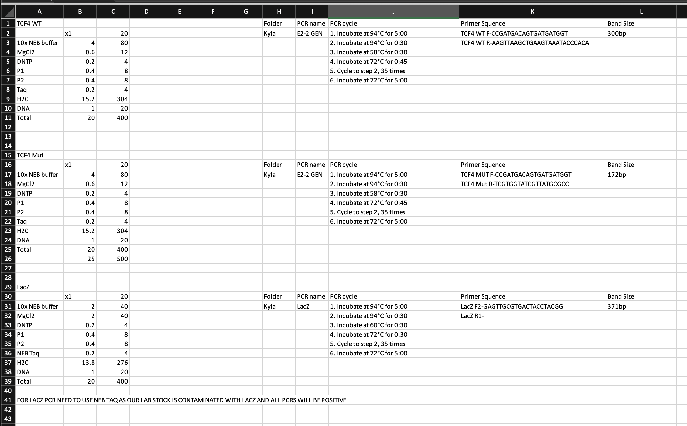

# PCR master mix recipe headings

[Download the original Excel workbook](PCR%20master%20mix%20recipes.xlsx){.btn .btn-primary download="PCR master mix recipes.xlsx"}

{fig-alt="Screenshot of the PCR master mix recipes spreadsheet" width=100%}

## [Id2flox](../../mol_bio/PCR/PCR%20Master%20Mix%20recipes/Id2flox.md)

## [Id2flox_current](../../mol_bio/PCR/PCR%20Master%20Mix%20recipes/Id2flox_current.md)

## [Id2flox Alt](../../mol_bio/PCR/PCR%20Master%20Mix%20recipes/Id2flox%20Alt.md)

## [Id3flox current](../../mol_bio/PCR/PCR%20Master%20Mix%20recipes/Id3flox%20current.md)

## [Id3flox](../../mol_bio/PCR/PCR%20Master%20Mix%20recipes/Id3flox.md)

## [P14](../../mol_bio/PCR/PCR%20Master%20Mix%20recipes/P14.md)

## [Cre](../../mol_bio/PCR/PCR%20Master%20Mix%20recipes/Cre.md)

## [PLZF Cre](../../mol_bio/PCR/PCR%20Master%20Mix%20recipes/PLZF%20Cre.md)

## [dLCK Cre](../../mol_bio/PCR/PCR%20Master%20Mix%20recipes/dLCK%20Cre.md)

## [Cre Reporter](../../mol_bio/PCR/PCR%20Master%20Mix%20recipes/Cre%20Reporter.md)

## [FOXO1](../../mol_bio/PCR/PCR%20Master%20Mix%20recipes/FOXO1.md)

## [NKT (va14g)](../../mol_bio/PCR/PCR%20Master%20Mix%20recipes/NKT%20%28va14g%29.md)

## [HEB KO](../../mol_bio/PCR/PCR%20Master%20Mix%20recipes/HEB%20KO.md)

## [HEBflox](../../mol_bio/PCR/PCR%20Master%20Mix%20recipes/HEBflox.md)

## [E2Aflox](../../mol_bio/PCR/PCR%20Master%20Mix%20recipes/E2Aflox.md)

## [Zeb2flox](../../mol_bio/PCR/PCR%20Master%20Mix%20recipes/Zeb2flox.md)

## [Tbetflox](../../mol_bio/PCR/PCR%20Master%20Mix%20recipes/Tbetflox.md)

## [OT-I](../../mol_bio/PCR/PCR%20Master%20Mix%20recipes/OT-I.md)

## [Bhlhe40](../../mol_bio/PCR/PCR%20Master%20Mix%20recipes/Bhlhe40.md)

## [HIFVHL](../../mol_bio/PCR/PCR%20Master%20Mix%20recipes/HIFVHL.md)

## [HIF2](../../mol_bio/PCR/PCR%20Master%20Mix%20recipes/HIF2.md)

## [E2-2 Reporter](../../mol_bio/PCR/PCR%20Master%20Mix%20recipes/E2-2%20Reporter.md)

## [E2-2 Conditional](../../mol_bio/PCR/PCR%20Master%20Mix%20recipes/E2-2%20Conditional.md)

## [USP1](../../mol_bio/PCR/PCR%20Master%20Mix%20recipes/USP1.md)

## [ER cre](../../mol_bio/PCR/PCR%20Master%20Mix%20recipes/ER%20cre.md)
